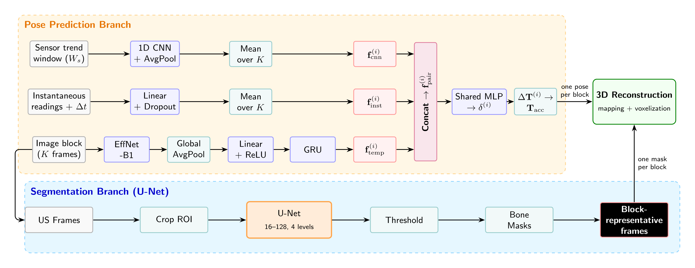

# Contact-Force Sensing for Trackerless Freehand 3D Ultrasound Reconstruction of Bone Surfaces

Code for the paper *Contact-Force Sensing for Trackerless Freehand 3D Ultrasound Reconstruction of Bone Surfaces* (currently under review).

A 2D ultrasound (US) probe is fitted with an IMU and a multi-zone tactile sensor. The **pose prediction branch** is a multimodal temporal fusion network. It estimates the relative probe motion between consecutive five-frame blocks from three inputs: the US images, the gravity-compensated acceleration and the contact force. The **segmentation branch** is a U-Net that extracts bone masks. The masks of the block-representative frames are mapped into 3D with the estimated poses and voxelized.



## Repository structure

```
├── data/
│   ├── prep.py              # raw recordings -> HDF5 (pose network)
│   ├── segment_prep.py      # PNG image/mask pairs -> .npy (U-Net)
│   ├── h5_check.py          # QC plots of the HDF5 files
│   ├── calib.py             # reads the calibration matrix
│   ├── calib_matrix.csv     # image-to-marker calibration
│   ├── raw_data/            # raw recordings (train / valid / test)
│   ├── intervals/           # scan intervals selected in prep.py
│   └── segment_data/        # U-Net training images and masks
├── freehand/                # dataset, network, sensor processing, transforms
├── unet/                    # U-Net model, dataset, loss
└── scripts/
    ├── train.py             # train the pose network
    ├── test_with_UNet.py    # test: trajectory + 3D bone reconstruction
    ├── UNet_train.py        # train the U-Net
    └── UNet_test.py         # export U-Net masks on the test set
```

All commands are run from the repository root.

## Installation

```bash
conda create -n tactile-us python=3.9
conda activate tactile-us
pip install torch torchvision --index-url https://download.pytorch.org/whl/cu118   # pick the build for your CUDA
pip install -r requirements.txt
```

## 1. Prepare data

### 1.1 Folder layout

```
data/
├── calib_matrix.csv
├── raw_data/
│   ├── train/
│   │   ├── <scan_name>/
│   │   │   ├── images/
│   │   │   │   ├── frame_000000.jpg
│   │   │   │   ├── frame_000001.jpg
│   │   │   │   └── ...
│   │   │   └── sensor_data.txt
│   │   └── ...
│   ├── valid/               # same structure as train/
│   └── test/                # same structure as train/
├── intervals/
│   ├── <scan_name>.json
│   └── ...
└── segment_data/
    ├── images/
    │   ├── <name>.png
    │   └── ...
    └── masks/
        ├── <name>.png
        └── ...
```

### 1.2 `data/raw_data/{train,valid,test}/<scan_name>/`

Each folder holds one recording session. The split is defined by the parent folder.

**`images/`**: the US frames captured from the scanner, as 640 × 480 JPEG files. They are read in grayscale. Each frame is cropped to the region starting at (x, y) = (217, 33) with size 240 × 360 (width × height), then resized to 60 × 90. To use another scanner, change `X_START, Y_START, WIDTH, HEIGHT` in both `data/prep.py` and `data/segment_prep.py`.

**`sensor_data.txt`**: a CSV file with a header row and one row per log entry. All streams share the host timestamp of the entry.

| Column | Content |
|---|---|
| `frame_id` | Row index |
| `timestamp_sec`, `timestamp_nsec` | Host timestamp (seconds and nanoseconds) |
| `imu_ax`, `imu_ay`, `imu_az` | Raw accelerometer reading in g, including gravity |
| `imu_qx`, `imu_qy`, `imu_qz`, `imu_qw` | IMU orientation quaternion (sensor → world, world z-axis up), e.g. from an on-board Madgwick filter |
| `force_values` | 78 comma-separated values in N, quoted as a single field. The first 3 values are the resultant force (F<sub>x</sub>, F<sub>y</sub>, F<sub>z</sub>); the remaining 75 are the force vectors of the 25 taxels |
| `fusion_px`, `fusion_py`, `fusion_pz` | Position of the probe marker from the optical tracker, in mm |
| `fusion_qx`, `fusion_qy`, `fusion_qz`, `fusion_qw` | Orientation quaternion of the probe marker (marker → world) |
| `flag` | Not used |
| `image_filename` | Name of the US frame in `images/` logged with this row |

The sensors are logged faster than the US frames, so consecutive rows can point to identical images. `prep.py` keeps one row per new image (MD5 deduplication). All rows are kept as the sensor stream for the sensor trend windows.

The optical tracker poses are the ground truth used for training and evaluation.

### 1.3 `data/intervals/`

One JSON file per recording, named `<scan_name>.json`:

```json
{
  "csv_spans": [[100, 1732], [1800, 2400]]
}
```

Each `[start_row, end_row]` pair is a range of row indices in `sensor_data.txt` and becomes one scan in the HDF5 file. If no file exists for a recording, `prep.py` opens an interactive window. Drag on the translation subplot to select the intervals, press `Z` to undo, and close the window to confirm. The selection is then saved to this folder. The interactive window needs a GUI matplotlib backend (Qt or Tk).

### 1.4 `data/calib_matrix.csv`

An 8 × 4 comma-separated matrix without a header:

- Rows 1–4: scale matrix `diag(s_x, s_y, 1, 1)`, where `s_x` and `s_y` are the pixel spacing (mm/pixel) of the original US image.
- Rows 5–8: rigid transform from the image frame (mm) to the probe marker frame (mm), obtained with a US calibration phantom.

Image coordinates are pixel coordinates of the cropped image. The resize factor is applied in the code. The image-to-marker transform used in training and test is

```
T_cal = T_rigid · T_scale · diag(4, 4, 1, 1)
```

### 1.5 `data/segment_data/`

Training data for the U-Net:

- `images/<name>.png`: US frames, 640 × 480, same field of view as `raw_data`.
- `masks/<name>.png`: binary bone masks with the same file name and size (bone = 255, background = 0).

### 1.6 Run preprocessing

```bash
python data/prep.py           # -> data/frames_res4_{train,valid,test}.h5 and data/he_global_lut_res4.npy
python data/segment_prep.py   # -> data/segment_data/processed_res4/{images,masks}/*.npy
python data/h5_check.py       # optional: QC plots in data/plotting/
```

`prep.py` must run first, because `segment_prep.py` reuses its histogram-equalization lookup table (`he_global_lut_res4.npy`).

For each frame, `prep.py` stores the following in the HDF5 files:

- the 60 × 90 (width × height) image;
- the 4 × 4 ground-truth tracker pose and its inverse;
- a 14-channel sensor vector: linear acceleration (3), IMU quaternion (4), force (3), shear force direction (2), Δt and CSV row index;
- per scan, the full sensor sequence and the mapping from frames to sensor rows.

Linear acceleration is gravity-compensated and normalized by 0.02 g. Force is normalized by 3 N.

## 2. Training

### 2.1 Pose prediction network

```bash
python scripts/train.py
```

The configuration is at the top of `scripts/train.py`:

| Parameter | Value | Meaning |
|---|---|---|
| `USE_IMU_ACCEL`, `USE_IMU_QUAT`, `USE_FORCE` | `True`, `False`, `True` | Sensor inputs (A+F+I) |
| `BLOCK_SIZE` | 5 | Frames per block (K) |
| `SEQ_LEN` | 5 | Blocks per window (S) |
| `SEN_WINDOW_SIZE` | 5 | Sensor trend window (W<sub>s</sub>) |
| `TRAIN_STRIDE` | 3 | Frame stride between training windows |
| `TEMPORAL_MODEL` | `"gru"` | Recurrent layer over block features |
| `NUM_EPOCHS` | 2500 | |
| `BATCH_SIZE` | 64 | |
| `LEARNING_RATE` | 1e-4 | Adam |
| `USE_AMP` | `True` | Mixed precision |
| `LOSS_TRAJECTORY_WEIGHT`, `LOSS_AUX_WEIGHT` | 0.65, 0.25 | λ<sub>t</sub>, λ<sub>a</sub> |

Outputs go to `results/seq_len5_blk5__lr0.0001__pred_parameter__label_point__sensor_AF_seq/`:

- `saved_model/best_validation_loss_model` and `saved_model/best_validation_dist_model`
- `saved_model/model_epochXXXXXXXX`: periodic checkpoints
- `epoch_log.txt`, `config.txt`, `convergence.png`, and TensorBoard logs

### 2.2 Segmentation network

```bash
python scripts/UNet_train.py
```

The model is trained on `data/segment_data/processed_res4/` with an 80/20 train/validation split and Focal + Dice loss. The best model is saved to `results/UNet/saved_model/best_model.pth`.

## 3. Test

### 3.1 Trajectory estimation and 3D reconstruction

```bash
python scripts/test_with_UNet.py
```

The script runs on all scans of `data/frames_res4_test.h5`. It loads `best_validation_loss_model` from the results folder of the matching configuration and the U-Net from `results/UNet/saved_model/best_model.pth`. The sensor flags, `SEQ_LEN`, `BLOCK_SIZE`, `SEN_WINDOW_SIZE` and `TEMPORAL_MODEL` must match the values used in training.

Windows are processed in chronological order with a stride of one block, starting from the ground-truth pose of the first block-representative frame. The bone masks of the block-representative frames are mapped into the world frame and voxelized at 0.5 mm.

Outputs go to the same results folder:

- `result.txt`: ε<sub>block</sub> (per-block error), ε<sub>acc</sub> (accumulated tracking error) and ε<sub>drift</sub> (final drift), overall and per scan
- `plotting/test_scan_<i>_pyvista.html`: interactive 3D view of the ground-truth and predicted trajectories and the reconstructed bone surface
- `plotting/test_scan_<i>_coords.txt`: ground-truth and predicted corner coordinates of the block-representative frames
- `plotting/motion_analysis/test_scan_<i>_motion_data.csv`: per-block positions and velocities
- `plotting/volumes_scan_<i>.npz`: voxel grids

Set `PLOT_MODE = "matplotlib"` to save static PNG trajectory plots instead.

### 3.2 Segmentation masks

```bash
python scripts/UNet_test.py
```

Runs the U-Net on every frame of the test HDF5 and saves the masks (`.npy`) and overlays (`.png`) to `results/UNet/test/`.

## License

Apache License 2.0. See [LICENSE](LICENSE) and [NOTICE](NOTICE).

## Acknowledgement

This code builds on [freehand](https://github.com/ucl-candi/freehand) by UCL-CANDI.
